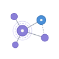

# Research Connected



  

Map how papers relate through citations, co-citations, and shared references, without leaving Obsidian. Start from one paper and get an interactive similarity graph in its own tab or inside a note.


## Features

- **Similarity map from one seed.** Enter a title, DOI, or OpenAlex ID. The plugin samples references, citing works, and related works from [OpenAlex](https://openalex.org/) and links papers by bibliographic coupling, co-citation, and direct citation.
- **Three layouts.** Planar groups papers by detected citation communities. Timeline places them by year. Radial places them by similarity to the seed.
- **Evidence for every link.** Select a paper or an edge to see why it is on the map: shared references, co-citation counts, citation direction, and which source reported it.
- **Research projects.** Mark papers as to read or read, stage them, exclude noise, deep dive from any node, and save named views. Everything is stored per seed in your vault.
- **Literature notes.** Write a paper to a note in a chosen folder with your own filename and body template. Reading status stays in sync between the note's frontmatter and the graph.
- **Graphs inside notes.** A `research-connected` code block embeds the same interactive graph in Reading view and Live Preview.
- **Export.** Copy the visible papers as BibTeX, YAML, or a Markdown table.
- **Cross-checked data.** Semantic Scholar, Crossref, and OpenCitations fill missing abstracts and reference lists and flag suspicious citation counts. Book reviews, editorials, and other non-research records are filtered out.
- **Optional research narrative.** Off by default. When you enable it and press **Generate**, a model you configure summarizes the sampled evidence.


## Installation

**From Obsidian.** Open **Settings → Community plugins → Browse**, search for **Research Connected**, then install and enable it.

**Manually.** Download `main.js`, `manifest.json`, and `styles.css` from the [latest release](https://github.com/Abe-Junwei/research-connected/releases/latest). Put them in `<vault>/.obsidian/plugins/research-connected/`, reload Obsidian, and enable the plugin under **Community plugins**.

Research Connected runs on Obsidian desktop 1.14.4 or later. Mobile support will follow device testing.

## Quick start

1. Run **Open Research Connected** from the command palette, or select the ribbon icon.
2. Enter a paper title, DOI, or OpenAlex work ID, then select **Build**.
3. Select a paper to read its details and relationship evidence. Right-click a node to **Exclude**, **Deep dive**, or **Set as seed**.
4. Use **Prior work** and **Later work** under the panel to find foundational and follow-up papers for the whole map.
5. Save the arrangement with **Save view**, so you can return to the same graph, selection, and filters later.

An OpenAlex API key is optional but recommended. Without one, OpenAlex allows a small daily budget and deep sampling reads only the first page of each list. Get a free key at [openalex.org/settings/api](https://openalex.org/settings/api) and paste it into the plugin settings.

## Embed a graph in a note

````markdown
```research-connected
doi: 10.1038/nature14539
height: 520
layout: temporal
```
````


The block accepts a seed (`doi:`, `openalex:`, or a bare ID) plus optional `position`, `width`, `height`, `labels`, `maxNodes`, `depth`, year range, filters, and `layout`. The older `connected-papers` block name still works. See [Embed a graph in a note](https://github.com/Abe-Junwei/research-connected/blob/main/docs/USER_GUIDE.md#embed-a-graph-in-a-note) for every option.

## Literature notes

Select a paper, then choose **Export → Write to note**. The plugin creates a note with this frontmatter and the body from your template:

```yaml
title: "Deep learning"
authors: "Yann LeCun, Yoshua Bengio, Geoffrey E. Hinton"
year: 2015
doi: "10.1038/nature14539"
openalex: "https://openalex.org/W2919115771"
rc-project: "Deep learning"
rc-status: unread
```

- Set the folder, filename template, and body template in settings. Templates can use `{{title}}`, `{{authors}}`, `{{year}}`, `{{doi}}`, `{{openalex}}`, `{{relation}}`, `{{project}}`, and `{{status}}`.
- When a paper already has a note in your vault (matched by DOI, then by OpenAlex ID), its details show **Open note**.
- Changing the reading status in the graph updates `rc-status` in the note. Editing `rc-status` in the note updates the graph the next time you open that paper.
- If another plugin, such as Zotero Integration, stores DOIs under a different property name, set **DOI property name** so existing notes are recognized.

## Network use and privacy

Research Connected needs network access to build graphs:

- **OpenAlex** receives the DOI, OpenAlex ID, or search text you enter, and your API key if you set one.
- **Semantic Scholar**, **Crossref**, and **OpenCitations** receive paper identifiers to fill missing metadata and check citations. API keys or tokens are sent only to the service they belong to.
- **Your LLM endpoint** receives the selected papers and their citation evidence only when you enable the research narrative and press **Generate**. Abstracts are included only if you turn that option on.

Projects, reading states, saved views, and service credentials are stored in this vault's plugin `data.json`. Credentials are **not encrypted**. The plugin sends no telemetry and does not read your notes beyond the frontmatter of literature notes. The interface follows Obsidian's language: Simplified Chinese for Chinese locales, English otherwise.

## Limitations

- The map is a **sample** of a citation neighborhood, not a complete citation index. Highly cited papers contribute their most-cited citers, not all of them.
- Similarity and community colors are exploratory signals. Verify important claims against the original papers.
- OpenAlex has known gaps: missing abstracts, incomplete reference lists, and author disambiguation errors. The [user guide](https://github.com/Abe-Junwei/research-connected/blob/main/docs/USER_GUIDE.md#data-quality-known-openalex-issues) lists each issue and what the plugin does about it.

## Documentation and support

- [User and technical guide](https://github.com/Abe-Junwei/research-connected/blob/main/docs/USER_GUIDE.md): settings, sampling, algorithm, and API details.
- [Roadmap](https://github.com/Abe-Junwei/research-connected/blob/main/ROADMAP.md): planned work, including multiple seed papers.
- [Issues](https://github.com/Abe-Junwei/research-connected/issues): bug reports and feature requests.

## License

[MIT](https://github.com/Abe-Junwei/research-connected/blob/main/LICENSE).

Research Connected is an independent project and is not affiliated with Connected Papers.
