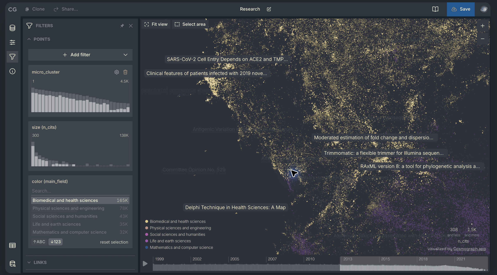

# 星图工作台完整落地方案

日期：2026-10-27。状态：规划完成，尚未实施。依据：用户提供的 Cosmograph 截图，以及当前 v1.9.4 的主图、内嵌、绘图、响应式与保存视图代码。

## 1. 已确定的设计要求

**布局尽量靠近参考图，所有界面配色继续适应 Obsidian 主题。** 不增加独立的夜空主题、固定深色模式或主题选择设置。深色宿主呈现夜间星图，浅色宿主呈现纸面星图；这是同一个界面的主题适配。



参考图保存在项目中，避免聊天附件的临时路径失效。它只作为设计参考，不作为产品运行时资源。

此要求取代先前调研中的“可选夜空外观”和固定海军蓝／金色建议。先前调研仍用于案例证据，不作为最新实现规范。现有 `.superdesign/design-system.md` 中“固定暖纸面与赭金”的描述应在实施第一步更新为宿主主题映射；保留其中紧凑、低装饰、主图与内嵌一致的要求。

## 2. 完成后的界面

```text
┌─────────────────────────────────────────────────────────────┐
│ 项目／重命名  种子检索＋构建          已存视图／保存  清单／导出 │
├────┬───────────────┬────────────────────────────────────────┤
│图标│ 筛选与图例     │ 图谱                           缩放／适配 │
│导航│ 关系类型       │                                         │
│    │ 配色含义       │        真实论文组成的星群                 │
│    │ 种子／经典标记 │                                         │
│    │               │                  选中时展开详情与证据栏  │
│    │               ├────────────────────────────────────────┤
│    │               │ 年份分布＋年份截止滑块＋播放（时间布局） │
├────┴───────────────┴────────────────────────────────────────┤
│ 当前样本数量／可见数量／状态／撤销                            │
└─────────────────────────────────────────────────────────────┘
```

示意图表示分区，不要求所有宽度同时显示所有面板。宽屏可并排，中等宽度优先保留图谱，窄屏沿用上下分区。

### 2.1 顶栏

- 宽窗口以单行约 44–48px 为目标；紧凑窗口允许受控的两行，不靠缩小文字硬塞。
- 左区为项目选择和重命名；中区保留种子输入与构建；右区为已存视图、保存视图及清单／导出入口。
- 种子论文完整标题与作者信息放在现有摘要区或详情中；顶栏只显示可截断的短标题，不让长标题撑开布局。
- “保存视图”保持现有含义，不能简写成会让用户误以为上传云端的 Save。空图、构建中和未选中论文时保持正确禁用状态。
- 项目／视图改名期间必须容纳输入框；中文输入法组合输入不触发提前提交。检索结果和错误提示可自然展开，不计入常态单行高度。

### 2.2 图标导航与左面板

- 保留约 44px 的窄导航带，复用三种布局图标；增加明确的“筛选与图例”入口。图标带不能随左面板关闭而消失。
- 左面板建议 260–280px，先固定宽度并可关闭，不新增左侧拖宽状态。标题、关闭按钮、分节与控件密度靠近参考图。
- 首版内容：已有关系类型开关、颜色含义、种子与经典文献标识、当前图谱统计。可以分成“连接”“标记与颜色”两节，不伪装成通用 Add filter 系统。
- 年份播放移到底部后，左栏不再重复出现滑块。清单继续承接暂存、排除与阅读操作，不混成第二套筛选 UI。
- 图例只有确实具备筛选能力的项才表现为按钮；社区色说明和统计项不能做成可点击假控件。
- 打开左面板不重新建图、不改变坐标、不改变缩放。其开闭继续复用 `leftCollapsed`。

### 2.3 画布与星图语言

- 使用宿主画布底色，以真实节点、局部柔光和细线形成星图；首版不做装饰背景纹理。
- 社区／年份／主题／宿主节点色模式继续表达原有数据；星图外观不覆盖颜色含义。节点半径、布局、相似度和引用方向沿用原逻辑。
- 种子用主题强调色细环；选中用更清晰的描边与完整标签，二者通过环形结构及图例区分。经典节点保留既有识别方式。
- 非聚焦边线使用宿主文字色的低透明度版本；聚焦边线保留关系类型色并提高辨识度。直接引用箭头不删除。
- 概览保留必要作者／年份标签；种子、选中和悬停标签优先放置，重点标签加主题色底板与内边距。沿用现有碰撞避让，文本框纳入避让范围。
- 靠边标签要换边或截断，底部时间条不盖住标签与鼠标命中区域。节点光晕不改变点击半径。
- 复用当前缩放、适配、重载与右键菜单，不增设框选、3D 或全屏模式。控件在键盘聚焦与触屏环境也必须可发现，不能仅依赖 hover。

### 2.4 右侧详情与证据

- 保留现在的 320px 初始宽度与 260–480px 拖宽范围；内嵌继续从 260px 起步，实际宽度受容器可用空间限制。
- 无旧视图偏好时，主图初始收起右栏，为图谱留出空间；选中论文或边时打开。已有明确 `rightCollapsed` 值时先恢复原值。
- 空白处点击清除选择但不自动关闭用户正在使用的面板；用户可手动关闭，再次显式选中论文／边时重新打开。
- 先验工作、衍生工作、研究脉络、清单、诊断与 DOI 路径等入口也必须能打开面板；不能只修节点点击路径。
- 关闭面板不清空选中状态、证据或正在填写的表单；请求完成只更新内容，不因异步回调强行弹开已经关闭的栏。
- 图谱页签和导出入口放到独立工作台操作区或顶栏，不能随右栏隐藏而失去入口；全程只有一套绑定。窄屏用已有原生菜单模式承接次要操作。
- 内嵌保留“在图谱中打开”及其既有功能边界，不把主图深挖和项目管理整套搬入笔记。

### 2.5 底部年份带

- 只在时间布局且至少有一个有效年份时显示；平面和径向布局保持图谱最大空间。移除左栏旧位置。
- 复用现有单截止年份语义：显示截至某年的论文；保留播放、暂停与全部年份恢复。不改成双端范围选择。
- 加入参考图式的小型年份分布柱。统计当前图谱样本中已纳入的文献，不读取完整数据库、不新增网络请求。
- 每年柱高表示样本文献数；完整分布保持稳定，用强调色标明当前截止位置。零计数年份保留位置；未知年份单独标注；所有有效年份柱计数之和应等于样本中有年份的论文数。
- 截止年份时未知年份论文按现有规则隐藏、种子始终保留；界面文案说明“种子始终显示”，避免柱图与可见数量被误认为矛盾。
- 只有单一年份时展示单柱与年份，停用无意义的播放；没有年份则显示简短说明，不放空白滑块。退出时间布局时继续沿用现有停止／恢复行为。
- 柱图先做说明性图形，操作仍由原生 range 完成；不增加刷选、缩放时间轴或另一套交互。图形提供文字摘要，不产生每个年份一个 Tab 焦点。
- 时间带约 56–72px，以实际字体测量确定；作为画布下方正常布局区域，避免绝对定位覆盖画布。

## 3. 主题适配规则

| 用途 | 优先使用的现有来源 | 行为 |
| --- | --- | --- |
| 工作台／详情底色 | `--background-primary`、`--background-secondary` | 宿主切换时即时跟随 |
| 正文／次要文字 | `--text-normal`、`--text-muted` | 与宿主字体、大小共同适配 |
| 边框／分节 | `--background-modifier-border` | 不写死灰色 |
| 操作／选择／种子环 | `--interactive-accent`、hover 与 focus 变量 | 保留宿主品牌色 |
| 图谱默认节点 | 宿主 `--graph-node`，缺失时使用主题相关 fallback | 不固定紫色 |
| 默认边／标签底板／柔光 | 已解析的主题文字、背景、强调色配合透明度 | 让 Canvas 与 HTML 呈现相同主题 |
| 社区、年份、关系类型 | 现有数据色带及图例 | 保持语义一致，必要时同时调整图例与 Canvas 的对比度 |

继续使用 `--rc-*` 这一层现有变量，只补确有用途的画布 token。Canvas 中重复读色收敛到一个内部方法，由 resize、主题变化和必要的布局更新复用；不创建通用主题框架。

需要覆盖节点、边、箭头、种子环、选中环、阴影、坐标轴、标签底板和文字。当前 `themeColor()` 只做合法性判断；新增带透明度处理时不能假定主题色总是 hex 或 `rgb()`，需验证 rgba、hsl、CSS 混色及实际支持的现代颜色格式。优先让浏览器解析，避免另写颜色解析器。

复用 `src/main.ts` 的 `css-change` → `research-connected-theme` 通知，HTML 与 Canvas 同步更新。切换主题不能重新发起请求、fit、重排、重置选择或清除筛选。CSS 自定义片段变化也应通过这一现有路径验证。

减少动态效果偏好需作用于 Canvas：禁用经典呼吸时保持静态光晕，停止其专用帧循环；不能只写 CSS media query。首版不增加任何持续动画。主题／媒体监听器在销毁时解除。

## 4. 响应式与状态

尺寸以插件／内嵌容器为准，不以整个应用窗口为准。下列是实施起点，最终用真实截图微调并固定进测试。

| 容器宽度 | 主图行为 |
| --- | --- |
| ≥1200px | 约 44px 图标带＋可固定的 260–280px 左面板＋图谱＋可展开右栏；两栏展开仍应保留至少约 480px 画布 |
| 780–1199px | 图标带常驻；左面板关闭时优先图谱＋证据；左面板打开时覆盖画布一侧，不再占用一整列；左面板和右栏不同时展开以挤窄图谱 |
| <780px | 使用现有上下分区：图谱在上、详情在下；筛选面板打开时替代下方详情区，关闭后恢复，避免两块面板叠放 |

内嵌不套用“主图宽屏默认展开左栏”的策略，默认紧凑并保留两侧入口。现有 560px 的内嵌窄模式阈值先保留；560–779px 也要检查展开面板后是否仍留有可用画布，空间不够就采用同一底部面板规则。不能只测跨过阈值时的截图。

- `observeResponsiveMode()` 作为宽度判断入口，扩展现有状态即可；避免 JavaScript 与 CSS 各自维护冲突的阈值。
- 中等／窄窗口的互斥、覆盖或上下布局是临时呈现状态；不要将因窗口变窄而强制收起的结果自动保存为用户偏好。
- 恢复旧视图时，尊重既有 `leftCollapsed`、`rightCollapsed`、缩放、中心、选中、布局和年份字段；缺失值才用新默认值。保持快照版本与现有数据格式。
- 关闭、展开和拖宽面板只改变视口尺寸；通过现有 resize 路径重绘，检查观察器反馈循环。右栏拖宽需限制剩余画布宽度。
- 面板关闭后焦点回触发按钮；Escape 先关闭顶层菜单，再关闭临时面板，不清除底层图谱状态。固定并排面板不做模态焦点锁；关闭内容不能继续出现在 Tab 顺序中。
- 面板互斥恢复、焦点和状态同步在共享外壳中处理，主图与内嵌只传各自默认值；不复制两个状态实现。

## 5. 当前代码与改动范围

| 文件 | 当前已有／本次职责 |
| --- | --- |
| `src/app.ts` | 主图顶栏、左右栏、选中与面板、保存／恢复视图。调整 DOM 分区和所有面板打开入口，保留数据管线。 |
| `src/embed-mount.ts` | 内嵌有相似面板、自己的临时视图状态与主题监听。接入共享分区，保留 `openGraph` 边界。 |
| `src/graph-surface.ts` | 已共用画布、缩放、菜单。补底部年份 host 与必要的共享面板呈现逻辑，防止重复实现。 |
| `src/graph-chrome.ts` | 已支持 `actionsHost`、`layoutHost`、`scrubHost`。优先换挂载位置；年份分布扩展现有时间控件，不另造第二套播放器。 |
| `src/filter-controls.ts` | 已有关系开关、图例与统计。按节重组，不引入通用筛选构建器。 |
| `src/map-canvas.ts` | 统一主题读取；主题化硬编码颜色；改标签底板／层次；处理减少动态效果。保持布局与命中语义。 |
| `src/responsive.ts`、`src/sidebar-resize.ts` | 容器尺寸、临时面板布局与右栏宽度约束；保留键盘调整能力。 |
| `styles.css` | 修改现有共享 surface contract 及相关旧规则，减少相互覆盖，不在文件尾持续堆高优先级补丁。 |
| `preview/index.html`、`preview/embed.html` 与其入口 | 复用 fixture；增加仅预览使用的主题切换／token 样例。现有预览写死暖白与赭金，必须补主题覆盖能力。 |
| `scripts/verify-ui.ts`、`scripts/verify-ui-contract.mjs` | 更新旧布局契约；补最小行为断言、主题／时间边界和状态兼容检查。 |
| `.superdesign/design-system.md`、`docs/USER_GUIDE.md`、README 及现有多语言说明 | 同步主题规则、操作位置、截图与一致性；生成设计稿时按实际源码刷新相关设计上下文。 |

重要现状：`GraphFilter` 虽有年份范围、语言、类型、概念等字段，主图目前主要通过 `setKinds()` 与年份截止操作接通界面；不能把类型定义当成已完成的筛选功能。本轮不新增社区／阅读状态／引用数阈值筛选。

现有 UI 契约包含“年份控件在左栏”“没有筛选 tab”等断言，会与本次设计冲突。实施时应改成新的行为要求，不能保留旧断言然后绕开。优先验证可见、可操作和状态正确，避免新增只匹配类名的脆弱测试。

## 6. 分步交付与通过条件

| 阶段 | 交付 | 通过条件 |
| --- | --- | --- |
| A：基线与设计合同 | 固定当前 fixture、主题／宽度矩阵与前后对照截图；更新主题设计规范 | 明确布局位置、已接通控件、旧视图样例。无真实网络数据波动。 |
| B：工作台结构 | 顶栏、常驻图标带、左面板、右证据栏与独立操作入口；主图和内嵌一起接入 | 关闭右栏仍能打开所有页签／导出；全部显式详情入口可用；无横向溢出。 |
| C：主题与星图 | Canvas 读色、线条／节点／标签层次、主题与动态效果处理 | 明暗及自定义主题实时切换，图数据、坐标、选择和视图不变。 |
| D：底部年份带 | 迁移现有滑块／播放，加入真实年份计数柱与摘要 | 两端年份、未知年份、单年／无年份、暂停与退出时间布局都符合约定；不增加请求。 |
| E：响应式与兼容 | 容器尺寸策略、面板互斥、焦点、拖宽边界与旧视图恢复 | 主图／内嵌各宽度可操作；临时尺寸变化不覆盖用户保存状态；无观察器循环。 |
| F：验证与交付 | 完整检查、浏览器实看、真实 Obsidian 抽查、截图与指南更新 | 验收矩阵通过后交付代码和预览；发布另按用户后续指令处理。 |

按 A→B→C→D→E→F 顺序落实，B 起就覆盖响应式基本可用性，E 集中验证边界，不把窄屏修复无限后置。不用给每阶段增加持久化功能开关；以版本控制保留原实现作为回退。

## 7. 验证矩阵与完成标准

### 自动检查

- 开始实施时先运行当前 `npm test` 和 `npm run build`，记录原有失败；每个有新逻辑的阶段留下一个能复现问题的最小断言，复用现有脚本。
- 覆盖：旧视图缺省／显式面板值；屏幕收窄后扩回；显式选择／异步更新的面板行为；主题颜色读取；关闭或销毁后的计时器／监听清理。
- 年份计数检查：空集、单年、缺失年份、年份间空档、截止年、种子保留；分布计数与有效样本总数一致。
- 最终运行 `npm test`、`npm run build`，再构建主图和内嵌预览。现有离线校验不是视觉正确性的替代。

### 浏览器与宿主实看

| 维度 | 必测组合 |
| --- | --- |
| 主图容器 | 1440、1200、1024、780、779、600、400px；780 和 1200 附近检查临界变化 |
| 内嵌容器 | 900、700、560、559、400px；每种默认与打开证据状态 |
| 主题 | 宿主默认浅／深；一个非默认强调色；一个不同背景色主题；打开图谱后实时切换 |
| 数据／状态 | 空图、构建中、搜索无结果、部分数据失败、默认约 50 节点、支持的 300 节点上限、排除恢复、长中英文标题 |
| 布局／交互 | 三种布局、年份播放、节点与边点击、缩放平移、右键、图例开关、左右栏开闭／拖宽、全部页签、导出及写入笔记 |
| 保存／恢复 | 项目切换、保存视图、旧视图恢复、内嵌重新挂载、窗宽变化、销毁重建 |
| 可访问性 | 键盘焦点、无鼠标操作入口、Escape 顺序、减少动态效果；文本 4.5:1 和关键交互图形 3:1 为对比度目标 |

主题和宽度不要求全笛卡尔组合：全套交互先跑默认主图宽屏；所有宽度跑关键入口与溢出；浅／深／自定义主题分别覆盖主图与内嵌，并检查 Canvas 同步。真实 Obsidian 至少抽查 css-change、分栏缩放、Reading view／Live Preview；无法访问时明确保留为未验收项。

性能采用相同设备、相同 fixture、相同操作的改前／改后对比。覆盖 50 和 300 节点拖拽、缩放、主题切换与静置；出现可重复的明显退化先修。减少动态效果开启时经典呼吸不应驱动连续重绘。`npm run perf` 如主要测建图算法，只作为回归补充，不冒充画布帧率测试。

完成必须同时满足：布局分区接近参考、宿主主题覆盖完整、全部既有功能入口可达、两个 surface 行为一致、旧数据可恢复、无新增外观网络请求、截图与使用说明反映实际结果。任一项未通过不得宣称完整落地。

## 8. 本轮明确不包含

不新增独立外观设置、框选、任意筛选器、社区／阅读状态筛选、3D、粒子星空、假节点、全库密度图、渲染依赖、图谱算法或数据服务改动。社区雾区也暂缓：先验证现有论文节点与标签是否更易阅读。大规模银河密度不在几十篇论文的界面中伪造。

预计复杂度主要在面板状态、主题化 Canvas 和窄容器，不能视为一次纯 CSS 换肤。当前文档只确认实施方案，未运行产品构建测试、未生成远程设计稿、未修改产品或发布版本。
