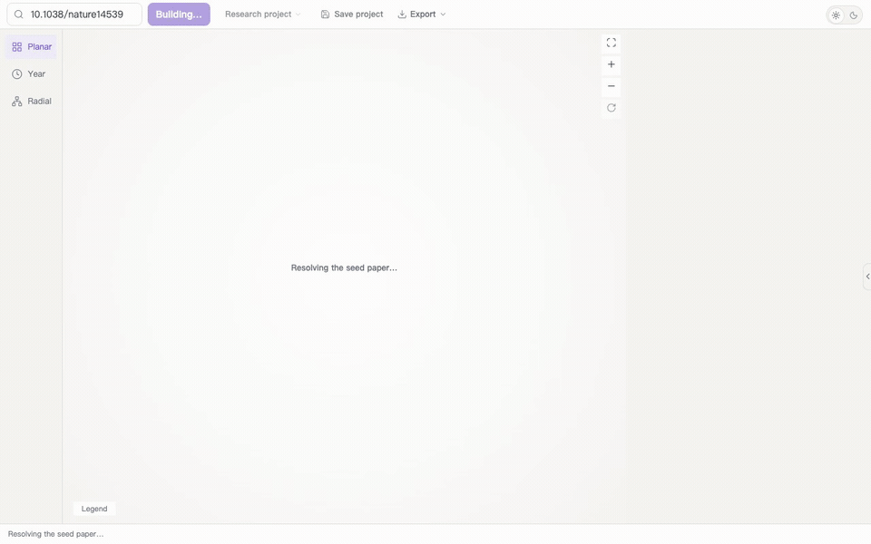
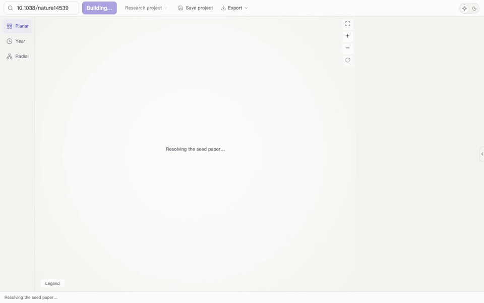
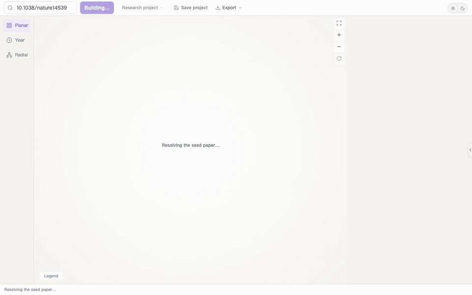
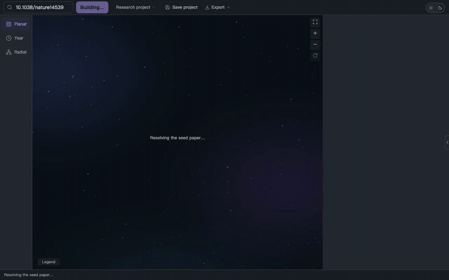
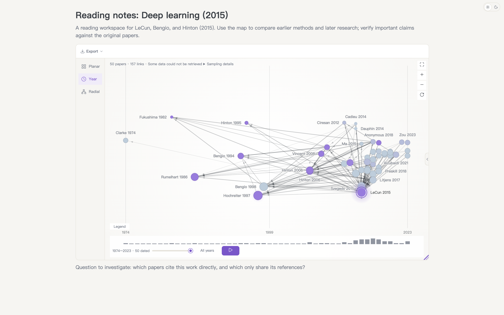
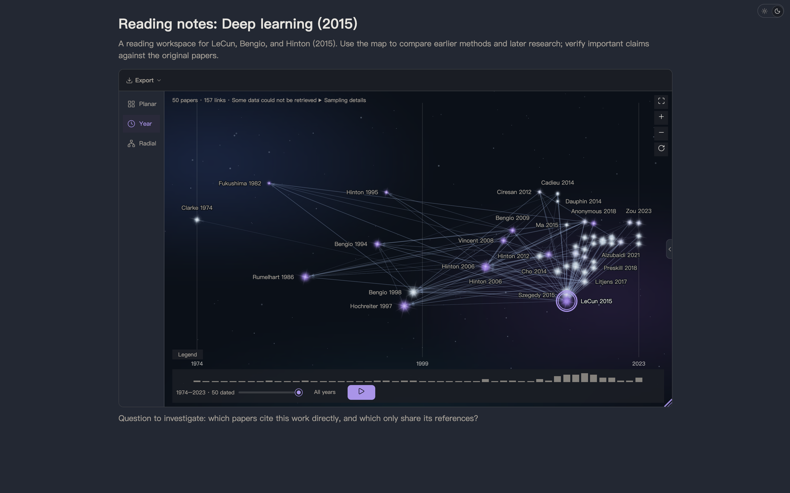

<h1 align="center">Research Connected</h1>

<p align="center"><a href="https://github.com/Abe-Junwei/research-connected/blob/main/README.md">English</a> | <a href="https://github.com/Abe-Junwei/research-connected/blob/main/docs/zh-cn/README.md">简体中文</a> | <a href="https://github.com/Abe-Junwei/research-connected/blob/main/docs/zh-tw/README.md">繁體中文</a> | <a href="https://github.com/Abe-Junwei/research-connected/blob/main/docs/ja/README.md">日本語</a> | 한국어</p>

<p align="center"></p>

<p align="center"><strong>논문 한 편에서, 연결된 연구 읽기로.</strong><br>관련 문헌을 찾고 연결의 근거를 확인하며, Obsidian에 문헌 노트를 쌓아 갑니다.</p>

<p align="center"><a href="https://github.com/Abe-Junwei/research-connected/blob/main/docs/ko/README.md#빠른-시작">빠른 시작</a> · <a href="https://github.com/Abe-Junwei/research-connected/blob/main/docs/USER_GUIDE.md">사용 안내</a> · <a href="https://github.com/Abe-Junwei/research-connected/issues/new?template=bug_report.yml">문제 보고</a> · <a href="https://github.com/Abe-Junwei/research-connected/issues/new?template=feature_request.yml">기능 제안</a></p>

<p align="center">  </p>

## 논문의 연구 이웃 살펴보기

<p></p>
<p></p>

*동적 시연과 정지 이미지는 현재 로컬 개발 미리보기입니다. 녹화일: 2026-10-29. 실제 Obsidian 화면이나 최신 배포 버전의 기능 보장이 아닙니다. 예시는 “Deep learning”(2015)이며 공개 메타데이터는 바뀔 수 있습니다. UI는 영어이고, 지원 언어는 중국어 간체와 영어입니다.*

노드나 간선을 선택하면 공통 참고문헌, 동시 인용, 직접 인용 근거를 확인할 수 있습니다. 오른쪽 패널 아래 탭의 ‘그래프에서 자주 인용된 문헌’은 현재 보이는 문헌 두 편 이상이 인용한 작품이고, ‘이 그래프를 인용한 문헌’은 현재 보이는 문헌을 두 편 이상 인용한 작품입니다. 출판 연도의 선후나 사상적 영향을 뜻하지 않습니다.

## 발견·확인·축적의 세 가지 작업 흐름

- **관련 연구를 찾습니다.** 제목, DOI 또는 OpenAlex ID를 입력해 시드 논문을 지정하고 표본으로 뽑은 유사도 지도를 만듭니다. **Planar**, **Year**, **Radial** 레이아웃을 바꿀 수 있습니다.
- **연결을 확인합니다.** 참고문헌과 인용 근거를 읽습니다. 플러그인은 OpenAlex, Semantic Scholar 또는 Crossref에서 초록과 참고문헌 데이터를 가져오려고 시도하고, OpenCitations에서 인용 근거를 추가할 수 있습니다. 요청 실패가 데이터베이스에 기록이 없다는 뜻은 아닙니다.
- **읽기를 정리합니다.** **Save paper**는 개별 논문을 프로젝트의 저장 목록에 추가하고, **Save project**는 프로젝트를 저장합니다. 논문의 **Reading status**를 설정하고, 불필요한 항목을 제외하고, 문헌 노트를 작성하거나 그래프를 삽입하고 BibTeX, YAML, Markdown으로 내보낼 수 있습니다.

## 빠른 시작

1. **설치하고 켭니다.** Obsidian에서 **설정 → 커뮤니티 플러그인 → 탐색**을 열고 **Research Connected**를 검색한 다음 설치하고 활성화합니다.
2. **첫 지도를 만듭니다.** 명령어 팔레트에서 **Open Research Connected**를 실행합니다. 아래 DOI를 붙여 넣거나 논문 제목으로 시드 논문을 선택한 뒤 **Build**를 선택합니다.
3. **연결을 확인합니다.** 논문이나 간선을 선택해 지도에 있는 이유를 봅니다. **Save project**로 프로젝트를 저장하고 **Save paper**로 개별 논문을 저장 목록에 추가합니다.

```text
10.1038/nature14539
```

이 예는 LeCun, Bengio, Hinton이 2015년에 발표한 “Deep learning”입니다. 원본 데이터베이스가 갱신되면 결과가 달라질 수 있습니다.

**수동 설치.** [최신 릴리스](https://github.com/Abe-Junwei/research-connected/releases/latest)에서 `main.js`, `manifest.json`, `styles.css`를 받아 `<vault>/.obsidian/plugins/research-connected/`에 넣습니다. Obsidian을 다시 불러온 뒤 플러그인을 켭니다.

## 시간 순으로 보기

<p></p>
<p></p>

**Year** 레이아웃으로 바꿉니다. 그래프 아래 연도 막대에서 출판 연도에 따라 표시 범위를 좁힐 수 있습니다.

## 노트 옆에 그래프 두기

<p></p>
<p></p>

아래 블록을 노트에 넣습니다. 읽기 화면과 실시간 미리보기에서 나타납니다.

````markdown
```research-connected
doi: 10.1038/nature14539
height: 520
layout: temporal
```
````

논문을 선택한 뒤 **Export → Write to note**를 고르면 문헌 노트가 만들어집니다. 플러그인은 DOI 또는 OpenAlex ID로 기존 노트를 알아봅니다. Reading status는 연결된 노트와 동기화할 수 있으며, 상태가 충돌하면 확인이 필요합니다. 폴더, 파일 이름, 본문 템플릿, DOI 속성은 설정에서 지정합니다.

임베드 옵션, 노트 속성(YAML frontmatter), 표본 추출, 알고리즘은 [사용 안내](https://github.com/Abe-Junwei/research-connected/blob/main/docs/USER_GUIDE.md)에 있습니다. 예전 임베드 이름 `connected-papers`도 동작합니다.

## 개발 상태

<details>
<summary>미출시 기능과 검증 범위</summary>

현재 [`slices/s02-s10`](https://github.com/Abe-Junwei/research-connected/tree/slices/s02-s10) 개발은 [PR #10](https://github.com/Abe-Junwei/research-connected/pull/10)에서 추적합니다. 실제 Obsidian 환경의 전체 검증은 아직 끝나지 않았습니다. 배포판 기능은 공식 릴리스를 참고하세요.

- 동일 논문과 확인된 버전 그룹의 읽기 상태를 공유하고, 저장과 제외는 프로젝트별로 관리합니다. 충돌과 외부 편집은 명시적으로 해결하거나 동기화를 재시도·중단합니다.
- 출처로 확인된 관계나 수동 결정으로 버전을 묶으며 제목만으로 추측하지 않습니다. 내보내기에 버전 출처가 남습니다.
- 후보 진단과 인용 경로는 증거 누락과 관측값 0을 구분합니다. MMR은 관련성과 다양성을 조절하고 의미 신호는 구조적 근거를 보완합니다.
- 노드 크기는 인용 수의 로그에 따릅니다. 고인용 표시는 설명이 있는 휴리스틱이지 권위 있는 평가가 아닙니다. 동작은 모션 감소 설정을 따릅니다.

</details>

## 시작하기 전에

- **데스크톱.** Obsidian 1.14.4 이상. 모바일은 기기 확인을 기다립니다.
- **네트워크.** 지도를 만들면 외부 학술 서비스에 질의합니다. 프로젝트와 읽기 상태는 보관함에 남습니다. 전송 정보는 아래 개인정보 안내를 확인하세요.
- **서비스 키.** OpenAlex API 키는 선택 사항이며, 설정을 권합니다. [OpenAlex 설정](https://openalex.org/settings/api)에서 만들 수 있습니다. 방법은 [안내](https://github.com/Abe-Junwei/research-connected/blob/main/docs/USER_GUIDE.md)에 있습니다.
- **표본.** 지도는 인용 이웃의 표본이며, 시드 논문을 인용한 모든 논문이 아닙니다.
- **노트.** 문헌 노트를 알아보려고 노트 속성(YAML frontmatter)을 읽습니다. 노트 파일은 노트를 쓰거나 읽기 상태를 바꿀 때만 바뀝니다.
- **AI.** 연구 서사는 기본적으로 꺼져 있습니다. 지도를 보는 데 언어 모델은 필요 없습니다.
- **인터페이스 언어.** 중국어 환경에서는 간체, 그 밖(한국어 포함)에서는 영어입니다. 위의 명령과 버튼 이름이 영어인 이유입니다.

## 네트워크 사용과 개인정보

- **OpenAlex**는 입력한 DOI, OpenAlex ID, 검색 텍스트와 설정한 API 키 및 선택 입력한 연락 이메일을 받습니다. 이메일은 Crossref에도 연락처 정보로 전달되며 요청 한도 증가를 보장하지 않습니다.
- **Semantic Scholar**, **Crossref**, **OpenCitations**는 논문 식별자를 받습니다. 키나 토큰은 해당 서비스에만 보냅니다.
- **언어 모델 엔드포인트**는 연구 서사를 켜고 **Generate research narrative**를 누른 뒤에만 선택한 논문과 인용 근거를 받습니다. 초록은 그 옵션이 켜져 있을 때만 포함됩니다.

기존 문헌 노트를 맞추려고 플러그인은 Markdown 경로를 나열하고 노트 속성(YAML frontmatter)을 읽습니다. 복사와 내보내기는 시스템 클립보드에 씁니다. 플러그인은 클립보드를 읽지 않습니다. 문헌 노트를 쓰거나 읽기 상태를 바꾸면 그 보관함 파일이 갱신됩니다.

프로젝트, 읽기 상태, 저장한 논문, 서비스 자격 증명은 이 보관함 플러그인의 `data.json`에 저장됩니다. 자격 증명은 **암호화되지 않습니다**. 보관함 동기화나 백업 도구가 이 파일을 복사할 수 있습니다. 플러그인은 원격 측정을 보내지 않으며, 문헌 노트 속성 밖의 노트 내용은 읽지 않습니다.

## 한계

- 지도는 **표본**이며 완전한 인용 색인이 아닙니다. 인용이 많은 논문은, 그 논문을 인용한 문헌 가운데 인용 수가 많은 것만 들어가며 전부가 아닙니다.
- 의미 유사도에는 호환되는 벡터뿐 아니라 로컬 텍스트와 주제 신호도 쓰일 수 있습니다. 연구의 질을 나타내지는 않습니다. 중요한 주장은 원논문과 대조하세요.
- OpenAlex에는 알려진 빈틈이 있습니다. 초록 누락, 참고문헌 목록 불완전, 저자 식별 오류입니다. [사용 안내](https://github.com/Abe-Junwei/research-connected/blob/main/docs/USER_GUIDE.md#data-quality-known-openalex-issues)에 각 빈틈과 플러그인의 처리가 있습니다.

## 도움과 피드백

- **동작하지 않습니다.** [문제를 보고](https://github.com/Abe-Junwei/research-connected/issues/new?template=bug_report.yml)하세요. 플러그인과 Obsidian 버전, 시스템, 단계, 기대한 결과와 실제 결과를 적습니다. 논문 데이터 문제에는 공개 DOI 또는 OpenAlex ID가 도움이 됩니다.
- **연구 절차를 바꿔야 합니다.** [기능을 제안](https://github.com/Abe-Junwei/research-connected/issues/new?template=feature_request.yml)하세요. 작업, 막힌 지점, 필요한 결과를 적습니다.
- **설치 도움.** [사용 안내](https://github.com/Abe-Junwei/research-connected/blob/main/docs/USER_GUIDE.md)를 읽고 [기존 이슈](https://github.com/Abe-Junwei/research-connected/issues)를 확인하세요.

영어와 중국어로 받을 수 있습니다. 제출에는 GitHub 계정이 필요하고, 보고는 공개됩니다. API 키, 개인 노트, 미공개 연구, 보관함 전체, `data.json`은 넣지 마세요. 기능 제안이 구현이나 제공 시점을 약속하지는 않습니다.

## 업데이트와 라이선스

변경은 [릴리스 노트](https://github.com/Abe-Junwei/research-connected/releases)에 있습니다. 예정된 작업은 [로드맵](https://github.com/Abe-Junwei/research-connected/blob/main/ROADMAP.md)에 있습니다. 코드와 문서 기여는 [기여 안내](https://github.com/Abe-Junwei/research-connected/blob/main/CONTRIBUTING.md)를 따릅니다.

[AGPL-3.0](https://github.com/Abe-Junwei/research-connected/blob/main/LICENSE). Research Connected는 독립 프로젝트이며 Connected Papers와 관련이 없습니다.
